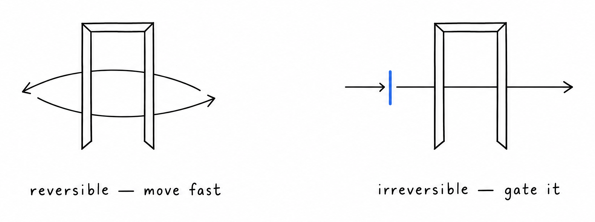
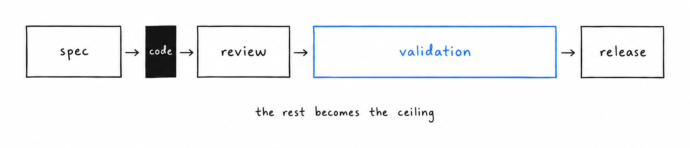
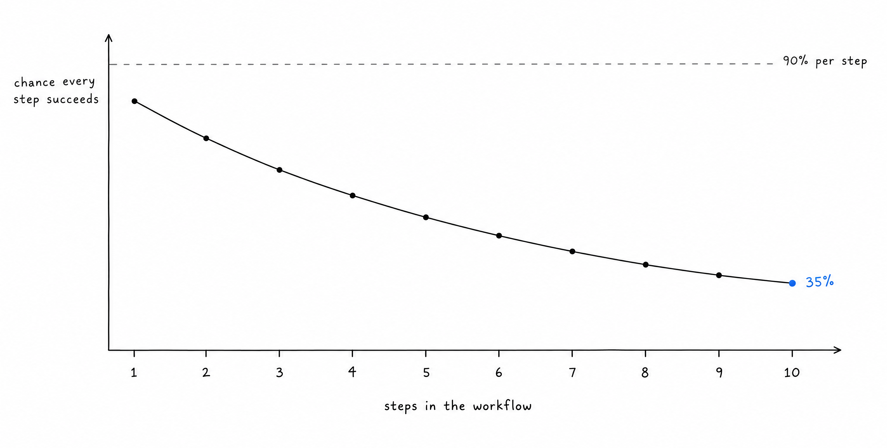
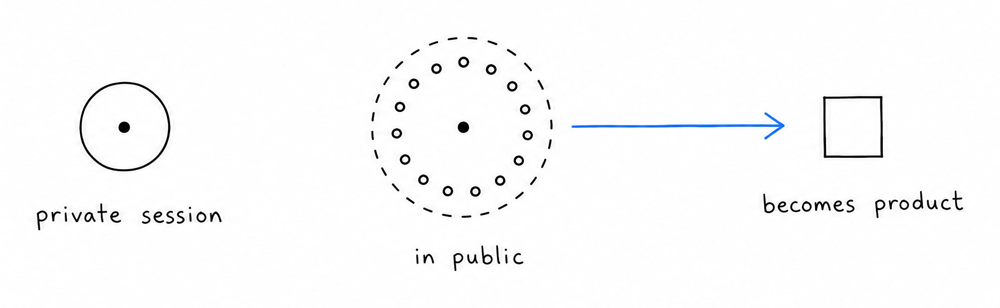

Product management rests on the premise that building software is expensive and that someone must therefore decide what gets built and in what order, and almost every ritual of the discipline, from roadmaps to sprint planning and estimation, follows from that single assumption about the cost of production.

Coding agents have broken that premise, since a prototype that took weeks now reaches users within days, and a team that still organizes itself around the scarcity of production ends up coordinating the part of the work that no longer needs it while neglecting the part that has become the bottleneck.

## The constraint moved from execution to judgment

A small team working with agents now produces more than a much larger team working the old way, so the limit is no longer how much can be built but how well the team knows what deserves to be built, whether it works once shipped, and which decisions cannot be taken back. Pull requests, demos and prototypes multiply as soon as production becomes cheap, which is why we measure ourselves by the problems that disappeared for our users rather than by the volume we produced.

## Plans describe outcomes rather than tasks

A plan used to split work into implementable pieces because those pieces were the expensive part, whereas today the useful content of a plan is what must be true once the work is done and which failures are unacceptable along the way, leaving people and agents free to choose the implementation and to be judged against what actually matters.

## Reversible and irreversible decisions get different speeds

Once building is cheap, the only cost worth managing carefully is the cost of what cannot be undone, so we move as fast as possible on anything that rolls back in minutes, such as a screen, an internal tool or an experiment on a slice of traffic, and we put explicit gates in front of anything that does not, such as a change to how data is stored, a commitment to a customer or an action an agent takes on behalf of a practice.

## Validation became the ceiling

Amdahl's law says that speeding up one part of a system improves the whole only as much as that part weighs in it, so writing code ten times faster barely changes delivery when specification, review, validation and release take as long as before, which is why we built monitoring, replay and fallbacks before most of our features and treat the speed at which we can validate a change as the real measure of our speed.

The behavior of an agent is a distribution over thousands of conversations rather than something anyone can read in the code, so every consequential change is checked against recorded conversations and then exposed to a fraction of live traffic in which its target metric has to move, and because a workflow succeeds only when all of its steps succeed, an agent that is right ninety percent of the time per step completes a ten-step workflow only about a third of the time, which is why we evaluate whole sequences and place verification gates inside long chains.

## Review checks intent, and documentation explains why

With agents writing a growing share of the implementation, a review is worth its time only when it asks whether the change solves the right problem, whether it drifts from what the team intended and whether it creates coordination costs for later, and documentation earns its place only when it records the reasons and constraints that the code cannot show, which is also why we delete any comment that merely restates what the code already says.

## We run our own use of AI in public

A long private session in which someone reconciles two exports every week looks like productivity, while the same session held in a public channel reveals a missing standard that the team repairs by hand every week, so we moved most of our AI use into the open, where work without an owner becomes visible and turns either into product or into something the customer can do on their own.

## Why we hire for seniority

We look for experienced people for their judgment and not for their technical depth, because the knowledge of a framework or an infrastructure that once took years to accumulate is now available on demand to anyone who knows what to ask an agent, whereas the judgment of someone who has lived with the consequences of their own decisions cannot be retrieved from a model.

That judgment is what lets someone see that a feature everyone agrees on solves the wrong problem, that a migration presented as routine cannot be rolled back, or that a generated change repeats a shortcut that already failed in production elsewhere, and it comes only from having been wrong in ways that cost something. It also includes the ability to step back, since a team for which production is nearly free can move very fast in the wrong direction, and the person who stops at the right moment to ask whether the work deserves to exist often contributes more than the one who ships the most.

We are hiring product engineers and product managers who want to work this way on problems where the stakes are real, through [our careers page](https://www.vocca.com/careers).
