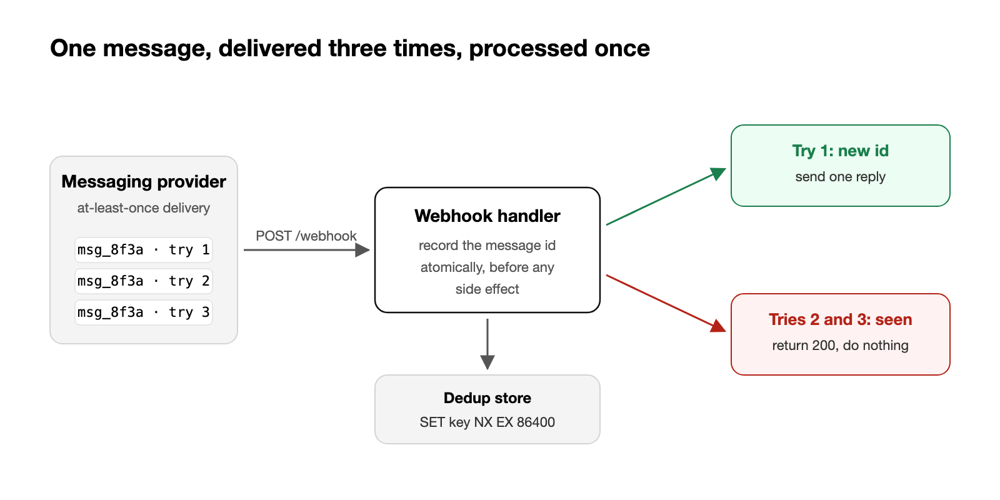

A patient replies "yes" to confirm an appointment. A few seconds later they receive the same confirmation message again. And again. On the worst thread we counted 25 copies.

Nothing in our code sent 25 messages on purpose. Each copy was a correct response to a webhook we had received. The problem was that we had received the same webhook many times, and treated every delivery as new.

This post walks through what happened, why it is a normal property of webhooks rather than a provider bug, and the small pattern we now use everywhere.

## At-least-once is the contract

Almost every webhook provider promises **at-least-once** delivery. If they do not get a fast `2xx` from you, they retry. If their own infrastructure hiccups, they may retry even when you did answer. Exactly-once delivery over the network does not exist; providers choose duplicates over lost events, and they are right to.

So "the provider sent it twice" is not an incident. "We acted on it twice" is.

In our case, a slow downstream step meant the handler sometimes answered after the provider's timeout. The provider retried, the retry hit a handler that had no memory of the first attempt, and each attempt sent its own confirmation. Under load the retries stacked up.

## The fix: remember what you have already done

The pattern is short. Before any side effect, try to record the event's unique id. If it was already recorded, stop.



```python
def handle_inbound(event: InboundMessage) -> None:
    # The provider's message id identifies the delivery we already processed.
    first_time = dedup.add_if_absent(
        key=f"inbound:{event.provider_message_id}",
        ttl_seconds=24 * 3600,
    )
    if not first_time:
        return  # duplicate delivery, already handled

    reply = decide_reply(event)
    send(reply)
```

`add_if_absent` must be atomic. With Redis that is a single `SET key 1 NX EX 86400`; with Postgres, an `INSERT ... ON CONFLICT DO NOTHING` on a table with a unique constraint, checking whether a row was inserted. A read followed by a write is not enough: two retries arriving in the same millisecond will both read "not seen".

## Three details that matter

**Use the provider's id, not a hash of the payload.** Two different messages can have identical bodies ("yes" is a very common reply). The provider's message id is the identity of the delivery; your hash is a guess.

**Pick the TTL from the retry window.** Check how long your provider keeps retrying and keep the key longer than that. A day is a comfortable default for most providers, and the table stays small.

**Answer fast, work later.** Return `200` as soon as the event is durably recorded, then process it in the background. Fewer timeouts mean fewer retries, and the dedup key protects you from the ones that remain.

## What about the side effect itself?

Deduplicating inbound events protects one boundary. The outbound side deserves the same care: if `send()` times out, did the message go out or not? Where the provider supports it, the next step is to pass an idempotency key on outbound calls too, derived from the inbound event id, so a retry of our own can never produce a second message.

## The rule we are adopting

Every webhook handler at Vocca should answer one question in code review: *what happens if this exact request arrives twice, ten seconds apart?* If the answer is "we do the thing twice", the PR is not ready.

It costs one atomic write per event. The alternative is a patient receiving the same message 25 times, which is exactly the kind of experience we exist to remove.

---

*We are hiring engineers in Paris and New York to work on problems like this one, on voice agents that handle real calls for healthcare practices every day.*
