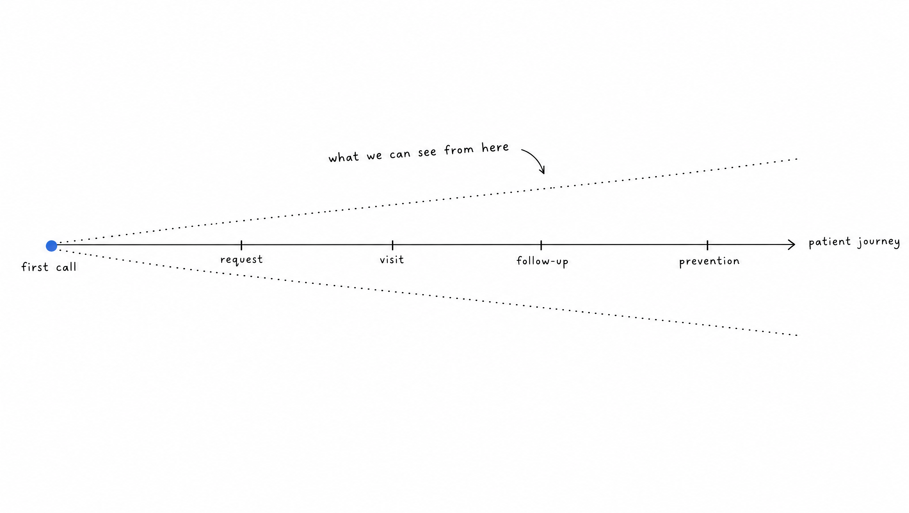
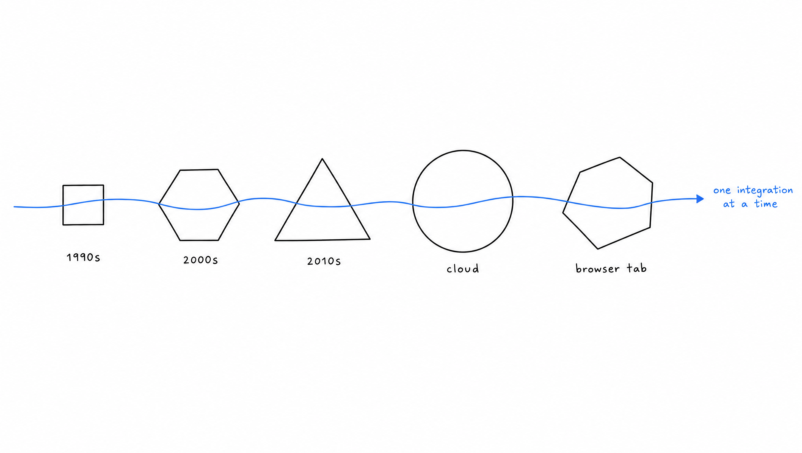
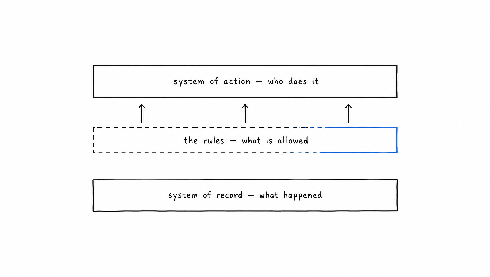
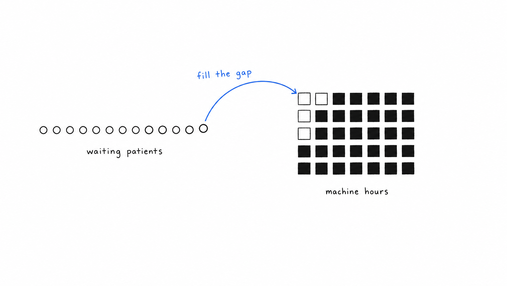

When Eliott and I started Vocca, we spent our first weeks looking at how patients actually get access to care, and the first thing we noticed was almost embarrassingly simple, which is that in most practices the phone rings during consultations and nobody is free to pick it up, so a large share of the people trying to reach a doctor never get past the first step of the journey. We built a voice agent to answer those calls, and today medical centers in several countries run their incoming requests through it, which means our software takes part in a very large number of conversations every day in which a patient explains what they need and expects something to happen as a result.

This article is an attempt to explain what we are building beyond that agent, why we think the phone was the right place to start, and what kind of engineering and product work the next stage requires, because the people we want to hire should be able to judge for themselves whether the problem is worth several years of their life.

## The phone gave us a seat at the entry of the patient journey

A phone call to a practice looks like a small interaction, but it carries an unusual amount of information about how healthcare works, since the patient has to say who they are, what is wrong, how urgent it feels, which practitioner they usually see, what their insurance covers and when they are available, and the practice has to answer by combining that request with its calendar, its rules and its knowledge of the patient's history.

Sitting at that point of the journey taught us something that is hard to see from anywhere else, which is that healthcare today is organized almost entirely around the capacity of providers rather than around the needs of patients, so a patient is seen when a slot happens to exist, followed for as long as someone remembers to follow them, and prioritized by the order in which requests arrive rather than by clinical need. None of this comes from a lack of care on the part of the people working in practices, who are usually doing far more than their schedules allow, but from the fact that no system has ever had a complete enough view of requests, capacity and history to organize the work differently.

What we are building is that system, one that knows each person's history and risk, brings them in before a condition becomes an emergency, and takes away from caregivers everything in their day that does not require their judgment, and the voice agent is simply the part of it that patients meet first.

## Most of the work happens where software meets other software

The model that understands what a patient says is only a small part of what makes a call end with a correct appointment, because the agent then has to read and write in the practice management software that holds the calendar, and that software varies enormously from one practice to the next, since many practices run on systems written long before anyone imagined connecting them to anything else, some of which still require an engineer to install them by hand on a server in the back office, while others install themselves in a few minutes and a few quietly stop working when someone closes a browser tab.

We build those integrations one system at a time, and inside each system we encode the specific way a given practice works, which motives it accepts on which days, which practitioner can see a new patient, how long a first visit lasts compared with a follow-up, and which requests must always reach a human. The approach we follow everywhere is to find the smallest thing that is actually costing a practice its patients and to start there, which is less glamorous than building a universal connector but is the only way we have found to make an agent trustworthy in a place where the rules are written nowhere except in the habits of the team.

## The layer that decides what is allowed

Underneath all of this sits a question that turned out to be the center of our product, which is where the rules live that decide whether a given action should happen, since a calendar stores what has been booked and a person or an agent does the booking, but the logic that decides whether this patient may be seen by this practitioner for this reason on this day has usually lived in neither place and survived only in the head of whoever has worked at the front desk the longest.

An agent that does not know what it is allowed to do remains a demonstration, so a large part of our engineering effort goes into making that layer explicit, in a form that the people it governs can read and change, that can be tested against past conversations before it goes live, and that can be traced afterwards so that any single decision can be explained by pointing at the rule that produced it. This also changes what a product means for us, because two practices may store their data in exactly the same way while almost never deciding in the same way, so much of what we build is less a single product for every customer than the machinery that keeps each customer's logic coherent as it evolves.

We hold that machinery to the same standard as the rest of our software, which in practice means that we validate a consequential change against recorded conversations before exposing it to a fraction of live traffic in which its target metric has to move, since the behavior of an agent is a distribution over thousands of conversations rather than a property anyone can read in the code, and a reliable workflow of many steps needs every step to hold rather than a high average across them.

## Where this goes next

The funding we raised this autumn, a Series A led by Norrsken VC with Speedinvest, firstminute capital and Heal Capital, goes into new countries and into products along three directions that follow from everything above, namely care that follows a patient continuously rather than visit by visit, prevention that reaches people before they become patients, and the use of what the data already shows to act earlier than medicine does today.

Medical imaging is a good example of what that looks like in practice, since patients often wait weeks for an MRI while, in the groups we work with, a significant share of machine hours stays empty because nobody has a complete view of who needs an exam, where there is room and which follow-up is due, and a system that sees every request, every free hour and every due follow-up across a whole group can keep very expensive machines full in a way that no team could manage by hand.

The same pattern repeats across specialties, because the information needed to organize care around the patient usually already exists somewhere in calendars, records and conversations, and what has been missing is a system that can hold all of it at once and act on it within the rules each practice has chosen.

## The people we are looking for

The work described here is spread across three teams, one focused on the AI that understands and conducts conversations, one on the platform that makes the whole system reliable and observable, and one on the interoperability work that connects us to the software practices already use, and the engineers who do best with us are the ones who want to own a problem from the conversation with the practice all the way to the code running in production.

We are hiring product engineers, and if the problems in this article are the kind you would like to spend your next years on, we would be glad to hear from you through [our careers page](https://www.vocca.com/careers).
