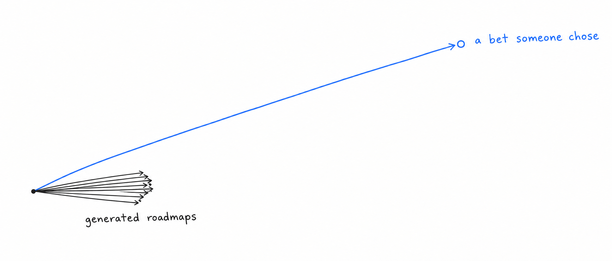
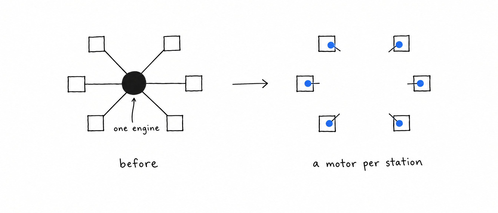

Over the past year, most of the documents that used to fill a product manager's week, from specifications and research syntheses to competitive analyses and first drafts of a roadmap, have become something an assistant produces in minutes, and the question we keep coming back to at Vocca is what remains of strategic product work once its most visible output costs almost nothing.

The most useful answer we have found comes from three economists at the University of Toronto, Ajay Agrawal, Joshua Gans and Avi Goldfarb, in *Prediction Machines* (2018) and its sequel *Power and Prediction* (2022), and although neither book is about product management, their argument applies to it with surprising precision.

## Cheap prediction raises the value of what surrounds it

Their starting point is a classic economic one, namely that when the cost of something falls sharply we use far more of it and the value of its complements rises, and their reading of AI is that it lowers the cost of one thing only, prediction, understood broadly as filling in missing information from the information available. A prediction is worth little on its own, since it only becomes valuable inside a decision, alongside three complements the model does not supply: judgment about what matters and what each mistake costs, data that others do not have, and the ability to act on the decision.

Much of what product managers used to produce was prediction in that sense, whether anticipating what users want, estimating the impact of a feature or describing what should be built, and that is precisely the layer that has become abundant. It is also why a generated roadmap tends to be coherent, well argued and generic, since it was produced from the same public information as everyone else's and lands very close to theirs.

## Judgment, knowledge from the field and action

Judgment is the most decisive of the three, because an assistant can produce ten defensible roadmaps but cannot tell which one matches the bet a company wants to make, and strategy consists precisely in giving up defensible options for the sake of a conviction that no amount of public data will produce. That conviction is only as good as the knowledge behind it, which is where proprietary data comes in, in the form of the calls a product manager has listened to, the mornings spent at the front desk of an imaging centre and the objections heard during sales, none of which exist in any training set. Action, finally, is what gives the rest an effect, since a decision that is not understood by the team, carried by the people who sell and deploy, and shipped to customers changes nothing for anyone.

## Redesigning the work rather than accelerating it

*Power and Prediction* adds a less comfortable point, which is that the gains from a general-purpose technology come from redesigning the system around it rather than inserting it into the existing one, as factories showed when they spent decades replacing the central steam engine with an electric motor and only saw productivity rise once they were rebuilt around small motors at each station.

Most product teams are at the electric motor stage, using AI to write the same specifications faster for the same rituals and the same review meetings, inside a process designed for a world in which producing analysis was expensive and thinking at length before building was therefore the cautious thing to do.

## How we work with this

In practice we ask our product managers to spend more of their time close to the work our product handles, listening to real calls and following deployments, because that is the knowledge our competitors cannot buy. We write each product direction as an explicit bet that states the conviction behind it, what we give up and the signal that would tell us we were wrong, and when an idea can be shown working within a day we build it rather than describe it, keeping documents for the decisions that commit the company for a long time.

If you would like to spend your time on judgment, field knowledge and execution, on problems where the stakes are real, we are hiring product managers and product engineers through [our careers page](https://www.vocca.com/careers).
