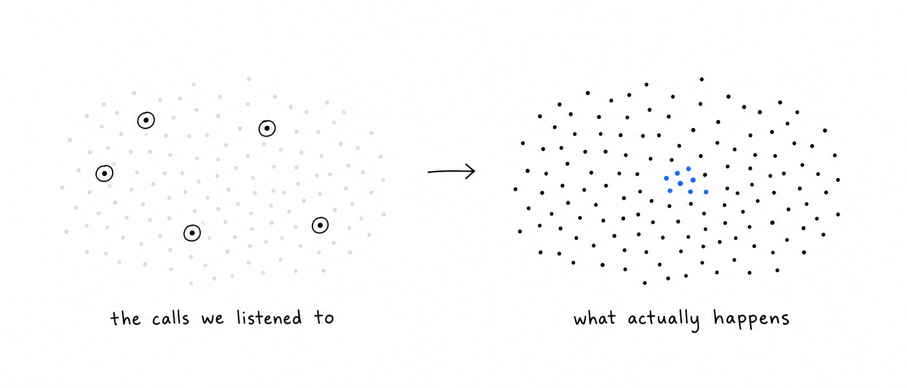

For most of its history, product management has worked at a distance from the thing it is trying to improve, since a product manager learns about users through a dozen interviews, a survey, a dashboard of aggregates and the anecdotes that reach them through sales and support, and each of these sources is either too small to be representative or too summarized to show what actually went on. A large part of the craft consisted in building a convincing picture of reality from very partial evidence, and in defending that picture against other pictures built from different evidence.

The framework that Ajay Agrawal, Joshua Gans and Avi Goldfarb set out in *Prediction Machines* (2018) and *Power and Prediction* (2022) is usually read as a story about automation, in which AI makes prediction abundant and value moves to whatever surrounds it. We find a less discussed consequence of their argument more useful for product work, which is that prediction, in their broad sense of producing missing information from available information, is also exactly what it takes to read raw material at scale, so the models that are changing how products are built are also changing how much of reality a team can see.

## Reality used to be read through samples

Our product answers phone calls for healthcare facilities, so the reality we care about lives in conversations, in what callers ask, where they hesitate, what the agent misunderstands and which requests end without a solution. Until recently, the only way to know what those conversations contained was to listen to some of them, which meant that what the team believed about its product depended on which calls happened to be heard and by whom, and that a problem affecting a small share of calls could remain invisible to us while being entirely familiar to the people working at the front desk.

## Every conversation can now be read

A model can now read every conversation, describe what happened in it, classify it against the questions we care about and point to the moment where it went wrong, so the question a product manager starts from has changed from what we think is happening to what the record shows. When someone raises a problem, the first step is no longer a discussion about how widespread it might be but a search across all conversations that returns how often it occurs together with a few real examples, and the discussion that follows starts from the same facts for everyone involved.

The same applies to our conversations with customers, since a concern raised by a facility can be checked against what its calls actually contain, which sometimes confirms it, sometimes reveals a different problem underneath, and in both cases makes the exchange more precise and more honest. All of this happens within strict rules on health data, with restricted access and examples that are anonymized before anyone outside the operational team sees them.

## Observation shortens the loop

The three economists insist on the role of feedback data, the observations that tell a system whether its predictions were right, and the same mechanism governs how fast a product improves. When observing the effect of a change takes minutes rather than weeks of waiting for anecdotes to come back, a team can ship a change, read what it did to real conversations and correct it within the same day, and the pace of improvement comes to depend on the quality of the questions asked of the record rather than on the difficulty of collecting it.

## What observation does not decide

Seeing everything does not tell a team what matters, because a complete record still has to be read with the right questions, and choosing those questions, then deciding what to do once the answer is known, remains a matter of judgment that no amount of observation replaces. What has changed is that this judgment now works from evidence that is complete rather than anecdotal, and that disagreements inside the team are more often resolved by examining the record together than by comparing opinions.

If you would like to build products this close to what actually happens, on problems where the stakes are real, we are hiring product managers and product engineers through [our careers page](https://www.vocca.com/careers).
