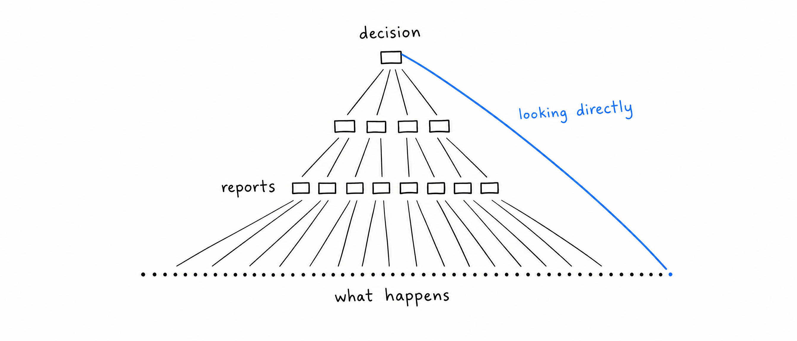
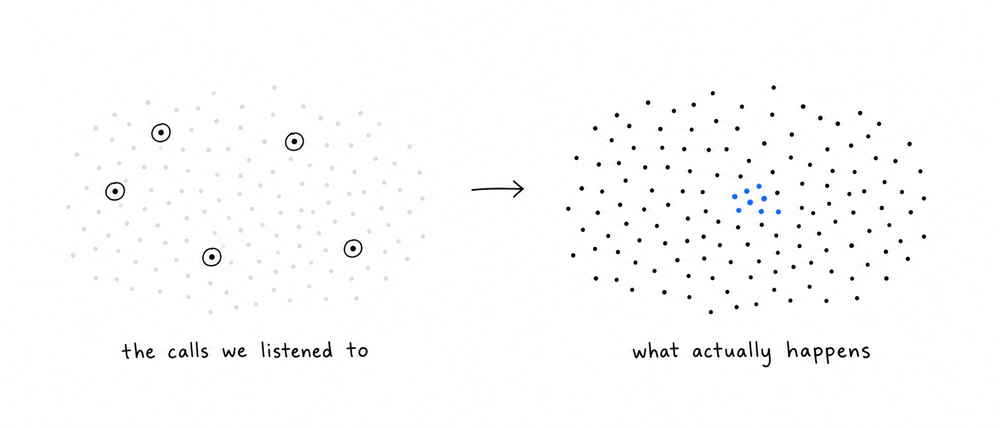

Most of the tools organizations use to understand the world were invented because looking at it directly was too expensive. When Laplace estimated the population of France in the 1780s from the registers of a few dozen communes rather than counting everyone, he was solving a problem of cost, and sampling, surveys, quarterly reports and dashboards all descend from the same constraint, which is that reality produces far more than anyone has the time to read.

Because of that constraint, large organizations learned to see through layers of summaries. James C. Scott described in *Seeing Like a State* how states made their territory legible by simplifying it into forms they could process, and companies did the same with indicators, so that a decision taken at the top usually rests on a report of a report of what happened, each layer keeping what it could carry and dropping the rest. Goodhart's observation that a measure stops being a good measure once it becomes a target follows from this arrangement, since people end up working on the indicator they are judged by rather than on the reality it was meant to describe.

## Reading is no longer the bottleneck

A growing share of reality now exists as records that nobody had the time to read, such as conversations, messages, documents and recordings, and language models can read all of them, describe what happened in each one and answer a question across the whole set. Ajay Agrawal, Joshua Gans and Avi Goldfarb describe AI in *Prediction Machines* as a fall in the cost of prediction, meaning the production of missing information from available information, and reading a record to say what happened in it is one of the most direct forms of that prediction, which is why its effect on how organizations see may turn out to be larger than its effect on how they produce.

## What it looks like at Vocca

Our product answers phone calls for healthcare facilities, so most of what happens in our business takes the form of conversations. Until recently we knew what those conversations contained through the few that someone had listened to, whereas today a question about them, such as how often callers ask for something we do not handle or at which point they give up, is answered by reading all of them, with access to health data kept restricted and examples anonymized before they are shared. A concern raised inside the team or by a customer now starts from the record rather than from the most convincing account of it.

## What changes when observation is easy

The most immediate consequence is that disagreements about facts become shorter, since a claim about what happens can be checked against everything that happened instead of being weighed against another claim, and indicators lose part of their authority as a result, remaining useful for following a trend while the explanation of any movement is found by reading the cases behind it rather than by building a theory about the number.

What does not change is that a complete record answers whatever it is asked and says nothing about what is worth asking, so choosing the questions and deciding what to do with the answers remains the part of the work that belongs to people, with the difference that it can now start from what actually happened rather than from what reached the top of the organization.

If you would like to work in a company that tries to look at what actually happens before deciding, on problems where the stakes are real, we are hiring product managers and product engineers through [our careers page](https://www.vocca.com/careers).
