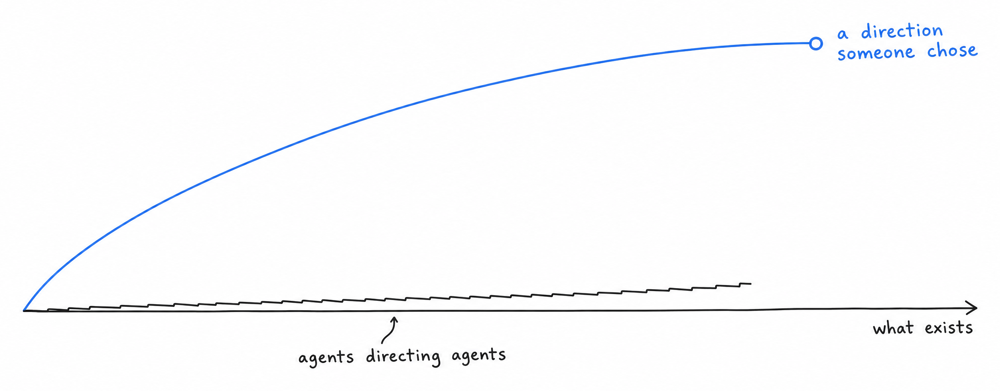

Over the past year, agents have taken on a growing share of the work at Vocca, from writing code to drafting plans and reviewing changes, and somewhere along the way I noticed a pattern that I did not expect and still do not fully understand, which is that they are excellent whenever the answer can be found in material that already exists and noticeably less convincing whenever it cannot.

My working explanation is a simple one. Every agent harness, however elaborate, gathers files, tickets, logs and instructions into a context window and then reasons over what it has gathered, so what it sees is the present state of things, while the reasons behind past decisions and the shape of what nobody has built yet are mostly absent from that window. This matters little when an agent executes a well defined task, and it seems to matter a great deal when we ask agents to plan, to prioritize or to direct other agents, which is the direction the whole industry, ourselves included, is moving in.

## The past that left no trace

Code records what was decided and rarely why, so the retry that looks redundant, the timeout that looks arbitrary and the feature we built and then removed after a pilot all appear in the context either as unexplained details or not at all, and the attempts we abandoned, which hold much of what our team has learned, leave no trace in the repository.

In practice, an agent extending a codebase follows the conventions it finds nearby rather than an intention that was only discussed in a meeting, and the only reliable way we have found to change that is to write the intention down, explicitly, somewhere the agent will read it.

## The future that has no trace yet

The opposite limit took me longer to see. When we asked agents where a part of the product should go next, the answers were careful, well argued and almost always a reasonable extension of what was already there, built from the current features, the open tickets and the most frequent requests, which makes sense once you consider that a direction nobody has formulated cannot be retrieved from any document.

## Why agents directing agents may drift towards the incremental

If both observations hold, an organization in which agents plan the work of other agents would tend to converge on a slightly better version of what it already does, because each step reasons from precedent and each proposal stays close to the most probable continuation of the present. That is a perfectly good outcome for maintenance, and I suspect it is a less good one for a young company whose reason to exist is to build something that was not there before.

I do not read this as a failure of the models, and I may well be wrong about how long it will last, but for now larger context windows do not seem to change it, since the missing material is not too long to fit but simply absent. The question it left us with was not whether to rely on agents, which we do for most of our implementation, but who brings what the context cannot hold.

## Taste brings the future

The answer we have arrived at, for now, is taste, which we understand as the ability to recognize that something is good before any precedent proves it, and to set aside something that is consistent with everything around it but does not deserve to exist. Some of the best decisions I have seen at Vocca came from someone looking at a technically correct proposal that extended the product in the most obvious way and explaining why our customers would be better served by something quite different.

## Agency acts on what nobody asked for

An agent acts on the task it was given, while many of the decisions that changed the course of our company were ones nobody had assigned, such as noticing that a process everyone worked around should not exist, that a customer request hid a more general problem, or that a direction we had agreed on months earlier no longer held. We look for people who take those decisions without waiting to be asked and who then write them down as explicit rules, since a written rule appears to be what lets an intention override the precedent agents would otherwise follow.

## Seniority carries the past

We value seniority for the memory it carries rather than for the technical depth it once implied, because knowledge of a framework is now available on demand to anyone who knows what to ask, whereas the memory of why a migration that looked routine turned out to be irreversible, or of why a shortcut failed in production somewhere else, exists only in the people who lived through it, and it is often what lets someone stop an agent that is about to remove a safeguard whose purpose nobody wrote down.

## What we are trying

None of this is settled for us, and the practices we have adopted are still evolving. We try to have every decision of consequence carry its reason next to it, so that the next person or agent who reads it inherits the why and not only the what, we state product intentions as explicit rules in the instructions our agents read rather than hoping they will be inferred from examples, and we keep the work of setting direction with people while agents take on more of the execution, which in practice means that the quality of that direction has become the thing we most need to get right.

If you would like to work on these questions with us, on problems where the stakes are real, we are hiring product engineers and product managers through [our careers page](https://www.vocca.com/careers).
